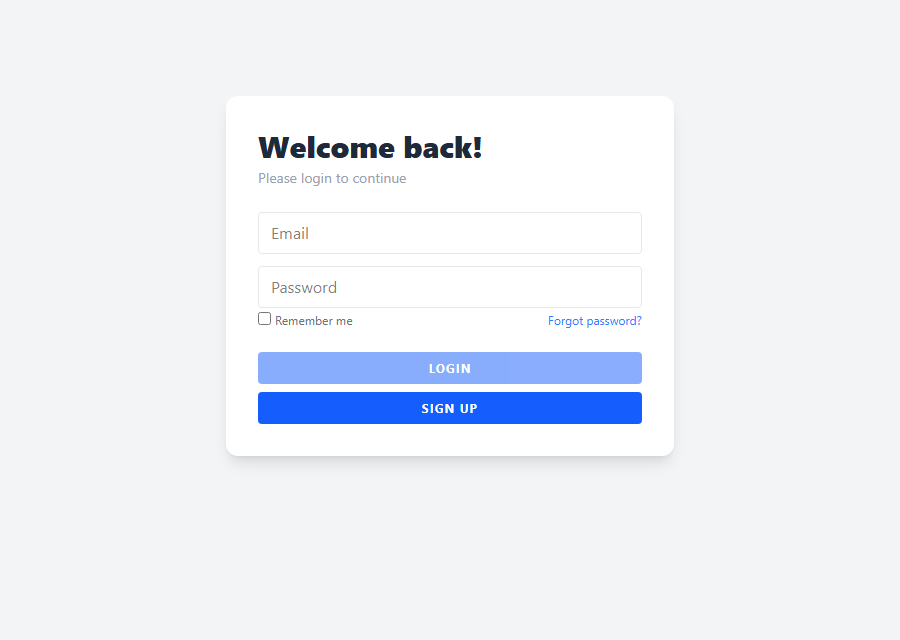
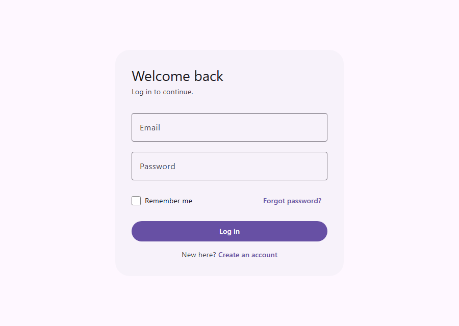
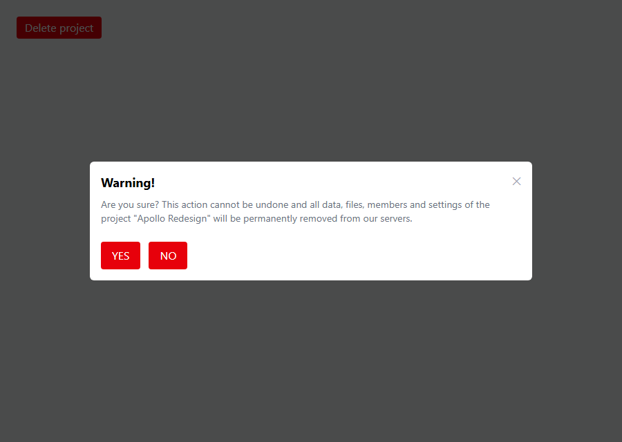
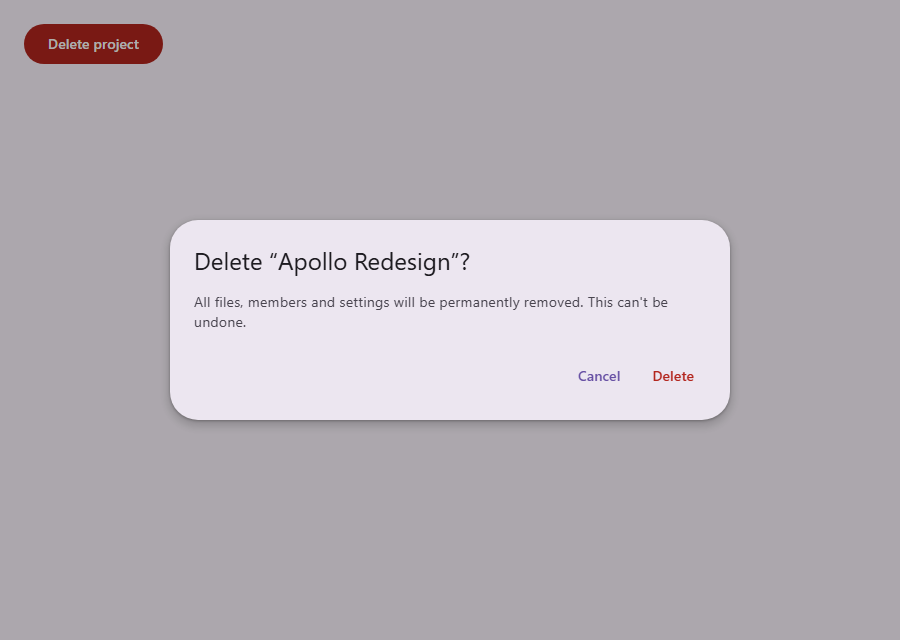
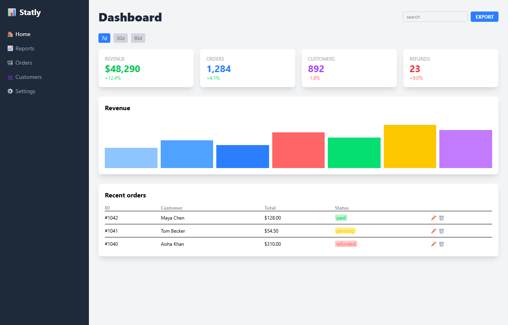
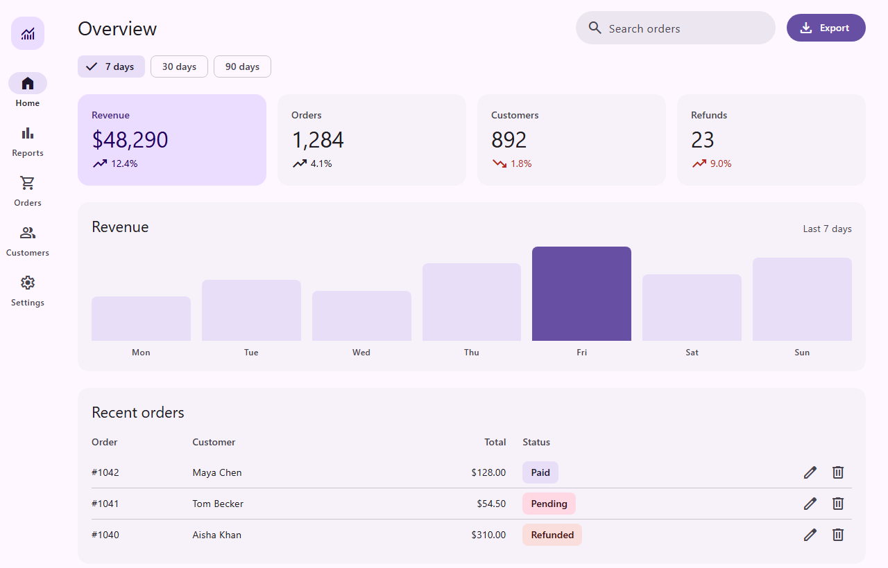

# material-design-web

A Claude Code skill for building and reviewing web UIs with Material Design 3 and Tailwind CSS v4.

## What's inside

- `SKILL.md`: skill entry point and instructions
- `assets/theme.css`: tested M3 token theme
- `references/`: foundations, components, layout, UX rules, Tailwind setup and review checklist
- `examples/`: sample build and review walkthroughs
- `scripts/`: `lint-tokens.mjs` catches silent rendering bugs, `audit-page.js` audits a page
- `evals/`: trigger and quality tests

## Before and after

Real inputs from `evals/quality/inputs/`, rebuilt with the skill.

**Login form**

| Before | After |
| --- | --- |
|  |  |

**Delete dialog**

| Before | After |
| --- | --- |
|  |  |

**Full dashboard** ([walkthrough](examples/dashboard-before-after.md))

| Before | After |
| --- | --- |
|  |  |

Also in [dark](examples/screenshots/dashboard-after-dark.png) and [phone](examples/screenshots/dashboard-after-phone.png).

## Examples

**Build a screen:** "Build a task list screen for a small productivity web app."
Claude frames the screen, builds a responsive page with empty, loading and error states, then self-checks it. See [build-tasks-screen.md](examples/build-tasks-screen.md).

**Review a component:** "Review this pricing card, it feels off."
Claude runs the linter and returns a prioritized report. See [review-pricing-card.md](examples/review-pricing-card.md).

## Install

Clone into your Claude Code skills folder:

```sh
git clone https://github.com/cmlcz/material-design-web ~/.claude/skills/material-design-web
```

## Usage

Claude loads the skill automatically when you ask it to build, restyle or review a web UI, or mention Material, M3 or Material You.

Not for native Android/iOS, or projects styled with Bootstrap, shadcn/ui, MUI or Chakra.
