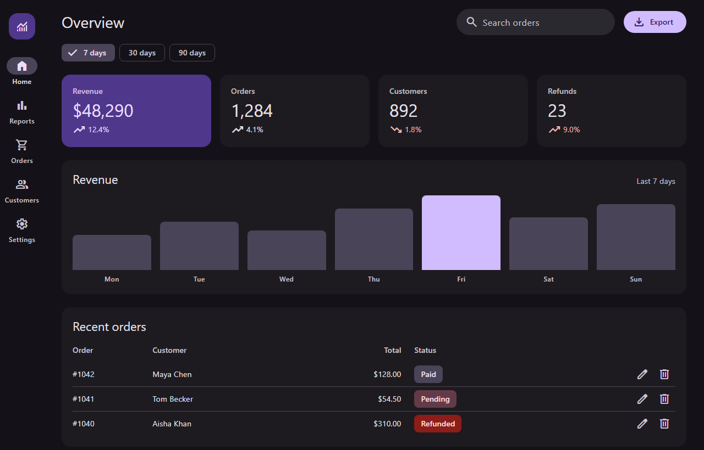
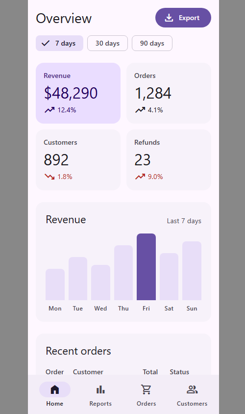

# Example: dashboard, before and after

> **Read when:** you want a full-screen example that covers layout, color, type, components, states and accessibility together.
> **Contains:** a typical generic Tailwind dashboard, what is wrong with it, how each problem was fixed, and the lint result.
> **Not here:** the rules themselves (see `references/`).

**Request:** "This dashboard looks generic and breaks on phones. Make it Material 3."

## Before


Typical problems:

- **Color:** default palette (`blue-500`, `green-500`, `purple-500`...). Every stat has its own color, so color carries no meaning. The chart bars are seven unrelated colors.
- **Type:** `text-xs` gray-400 labels (low contrast), `font-black` title, uppercase shouting buttons.
- **Shape and depth:** `shadow-lg` plus `rounded-lg` on everything, so nothing stands out.
- **Icons:** emoji in navigation and row actions. They render differently per OS and have no accessible names.
- **Components:** the date range is three look-alike gray boxes with no selected-state semantics. Row actions are about 16px wide. Status pills use low-contrast `text-yellow-400` on `bg-yellow-200`.
- **Layout:** fixed 224px sidebar and a four-column grid, so it breaks on a phone. The table has no `<th scope>`.

## After


| Dark | Phone |
| --- | --- |
|  |  |

## What changed and why

| Problem | Fix | Reference |
| --- | --- | --- |
| Rainbow stats and bars | One tonal card (`bg-primary-container`) for the headline number, the rest `bg-surface-container-low`. One highlighted bar (`bg-primary`) in a row of `bg-secondary-container`. Color now says "this one matters". | `foundations/color.md` |
| Default palette and type sizes | Role classes only: `bg-surface`, `text-on-surface-variant`, `text-headline-large`, `text-label-large`. Dark mode comes free from `light-dark()` in the theme: no `dark:` classes. | `tailwind/naming.md` |
| Emoji icons | Material Symbols with `aria-hidden`; icon-only buttons get `aria-label` ("Edit order 1042"). | `tailwind/setup.md` |
| Shadow and radius everywhere | Tonal surfaces instead of shadows. Corners from the shape scale: cards `rounded-corner-large`, chips `rounded-corner-small`, buttons `rounded-corner-full`. | `foundations/elevation.md`, `shape.md` |
| Look-alike date buttons | Filter chips: `aria-pressed`, check icon on the selected one, wrapped in `role="group"`. | `components/actions.md` |
| 16px row actions | 40px icon buttons with `touch-target` (48px hit area). | `ux/accessibility.md` |
| Low-contrast status pills | Container pairs (`bg-tertiary-container` with `text-on-tertiary-container`), which pass AA in both themes (`contrast-check.mjs`). | `foundations/color.md` |
| Fixed sidebar | Navigation rail from 600px up, bottom navigation bar below. Same links in both, `aria-current="page"` on the active one. | `layout/navigation-patterns.md` |
| Four-column grid on a phone | `grid-cols-2`, then `large:grid-cols-4`. The table scrolls inside its card instead of overflowing the page. | `layout/window-size-classes.md` |
| Plain table | `<th scope="col">`, right-aligned `tabular-nums` totals, visually hidden "Actions" header. | `ux/accessibility.md` |

## Gotcha worth knowing

The theme replaces Tailwind's breakpoints with M3 window classes. `md:` and `lg:` do not exist: use `medium:` (600px), `expanded:` (840px) and `large:` (1200px). The first draft of this page used `md:` and silently rendered the phone layout at desktop width.

## Verification

```
node scripts/lint-tokens.mjs dashboard-before.html   # 50 errors, 39 warnings
node scripts/lint-tokens.mjs dashboard-after.html    # 0 errors, 0 warnings
node scripts/contrast-check.mjs                      # 60/60 pairs pass
```

Screenshots were taken in headless Chrome at 1280px (light and dark) and 390px.
